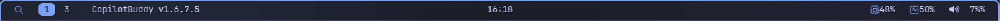

<div align="center">

# winRice

**Windows 11 en mosaico y manejado por teclado, con los colores de Tokyo Night.**




[English](README.md) · [Русский](README.ru.md) · [简体中文](README.zh-CN.md) · **Español** · [Português (BR)](README.pt-BR.md)

</div>

## Instalación

```powershell
git clone https://github.com/Erzkanzler2k/winRice
cd winRice
powershell -ExecutionPolicy Bypass -File install.ps1
```

Requiere Windows 11 22H2+ y `winget`. El script instala GlazeWM, YASB, WezTerm, Starship y Fastfetch, copia las configuraciones, pone el fondo de pantalla, oculta los iconos del escritorio y registra el inicio automático. Es idempotente: vuelve a ejecutarlo tras cualquier cambio.

## Teclas

`Alt` o `Win` + …

| Teclas | Acción |
|:--|:--|
| `H J K L` | enfocar ventana |
| `Shift + H J K L` | mover ventana |
| `1..9` | escritorio |
| `Shift + 1..9` | ventana al escritorio |
| `R` | modo redimensionar (`Esc` sale) |
| `V` | dirección del mosaico |
| `F` | pantalla completa |
| `Shift + Space` | ventana flotante |
| `Q` | cerrar |
| `Space` | lanzador |
| `Enter` | WezTerm |
| `Shift + R` | recargar configuración |

`Alt + S` / `Alt + A` — escritorio siguiente / anterior. `Alt + Shift + E` — salir de GlazeWM.

## Archivos

| En el repo | Se instala en |
|:--|:--|
| `glazewm/config.yaml` | `%USERPROFILE%\.glzr\glazewm\config.yaml` |
| `yasb/` | `%USERPROFILE%\.config\yasb\` |
| `wezterm/.wezterm.lua` | `%USERPROFILE%\.wezterm.lua` |
| `starship/starship.toml` | `%USERPROFILE%\.config\starship.toml` |
| `fastfetch/` | `%USERPROFILE%\.config\fastfetch\` |
| `wallpaper/tokyonight.png` | `%USERPROFILE%\Pictures\winRice-wallpaper.png` |

Paleta: fondo `#1a1b26`, texto `#c0caf5`, acento `#7aa2f7`, atenuado `#565f89`.

## Notas

- La barra se oculta con apps en pantalla completa (`hide_on_fullscreen` en `yasb/config.yaml`).
- Algunas combinaciones con `Win` siguen siendo de Windows: usa la variante con `Alt`.
- El menú Inicio y la barra de tareas nativos no se tocan; el lanzador es `Alt+Space`.
- Registros: `~\.config\yasb\yasb.log`, `~\.glzr\glazewm\errors.log`.

## Créditos

[GlazeWM](https://github.com/glzr-io/GlazeWM) · [YASB](https://github.com/amnweb/yasb) · [WezTerm](https://wezterm.org) · [Starship](https://starship.rs) · [Fastfetch](https://github.com/fastfetch-cli/fastfetch) · [JetBrains Mono NF](https://github.com/ryanoasis/nerd-fonts) · paleta [Tokyo Night](https://github.com/folke/tokyonight.nvim) · inspirado en [Omarchy](https://github.com/basecamp/omarchy).

[MIT](LICENSE) © 2026 Erzkanzler2k
