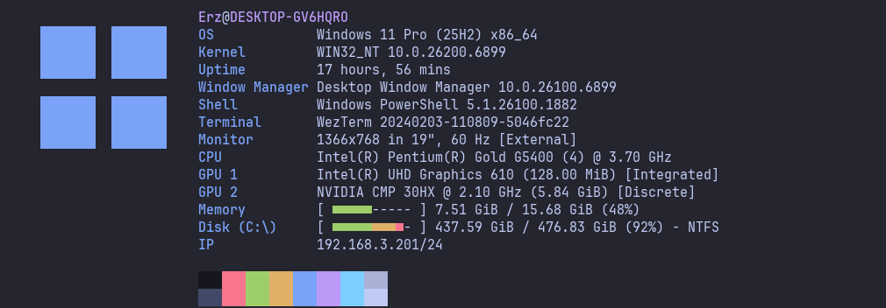

<div align="center">

# winRice

**A tiling, keyboard-driven Windows 11 desktop with the ergonomics of Hyprland and the looks of Tokyo Night.**

A tethering-free, dependency-light rice: GlazeWM tiles, YASB draws a waybar-style bar, WezTerm and Fastfetch carry the shell. One PowerShell script installs it, backs nothing up silently, and can be undone.


</div>

---

## Table of contents

- [Why](#why)
- [Features](#features)
- [Requirements](#requirements)
- [Install](#install)
- [Verify](#verify)
- [What the installer changes](#what-the-installer-changes)
- [Keybindings](#keybindings)
- [Configuration](#configuration)
- [Troubleshooting](#troubleshooting)
- [Uninstall](#uninstall)
- [Credits](#credits)
- [License](#license)

## Why

Windows 11 can tile, but only through snapping. This repo turns it into a proper tiling desktop:

- **Keyboard-first.** Windows are addressed by direction, not by dragging.
- **Declarative.** Every visual decision lives in a file in this repo, not in a settings app.
- **Portable.** A fresh machine gets the same desktop from one script.
- **Reversible.** No system files are patched; every change is a config file or a user-level registry value.

## Features

| | |
|:--|:--|
| **Tiling** | GlazeWM with `Alt`/`Win` + `hjkl`, 9 workspaces, 6 px gaps, rounded corners, no title bars, accent border on the focused window. Tiling direction on `Alt+V`. |
| **Status bar** | YASB, 30 px on top: launcher, workspaces, active window title, clock, CPU, RAM, volume. Tokyo Night palette, DWM blur, 55 % opacity. Hidden on fullscreen apps. |
| **Launcher** | `Alt+Space` or the magnifier: searchable app list with icons, keyboard driven, no mouse required. |
| **Terminal** | WezTerm: Tokyo Night ANSI palette, JetBrainsMono NF, acrylic backdrop at 82 %, no window frame, splits on `Ctrl+Shift+D` / `E`. |
| **Shell** | Windows PowerShell + Starship `λ` prompt. `fastfetch` runs on every new WezTerm tab with a Windows 11 logo in the accent colour and memory/disk bars. |
| **Desktop** | Generated Tokyo Night wallpaper, desktop icons hidden, Windows transparency effects on. |
| **Autostart** | GlazeWM and YASB are registered to start at login. Nothing else is left running by the installer. |

<div align="center">
  
</div>

## Requirements

- Windows 11 (22H2 or newer). Windows 10 is untested.
- `winget` (App Installer) available in `PATH`.
- PowerShell 5.1 — ships with Windows, so nothing to install.
- ~250 MB of disk for the packages.

No admin session is required for the configs, wallpaper or autostart. The `winget` step may prompt for elevation on a machine-wide package.

## Install

```powershell
git clone https://github.com/Erzkanzler2k/winRice
cd winRice
powershell -ExecutionPolicy Bypass -File install.ps1
```

Then sign out and back in — or start the two processes once by hand:

```powershell
Start-Process 'C:\Program Files\glzr.io\GlazeWM\glazewm.exe'
Start-Process 'C:\Program Files\YASB\yasb.exe'
```

The script is **idempotent**: re-run it after any change to this repo and it re-syncs configs, wallpaper and autostart. Existing config files at the destination paths are overwritten.

### Installed packages

| Package | Role |
|:--|:--|
| `glzr-io.glazewm` | tiling window manager |
| `AmN.yasb` | status bar |
| `wez.wezterm` | terminal |
| `Starship.Starship` | prompt |
| `Fastfetch-cli.Fastfetch` | system fetch |
| `DEVCOM.JetBrainsMonoNerdFont` | font with Nerd Font glyphs |

## Verify

```powershell
glazewm query app-metadata          # GlazeWM is alive and answering on its IPC
yasbc -v                            # YASB version + config directory
wezterm --version                   # terminal
fastfetch -c "$env:USERPROFILE\.config\fastfetch\config.jsonc"
```

Expected: the bar is visible on top, `Alt+Space` opens the launcher, `Alt+Enter` opens WezTerm with a `λ` prompt, and `Alt+H/L` moves focus between tiled windows.

## What the installer changes

| Target | Change |
|:--|:--|
| `%USERPROFILE%\.glzr\glazewm\config.yaml` | GlazeWM config (copy of `glazewm/config.yaml`) |
| `%USERPROFILE%\.config\yasb\` | YASB `config.yaml` + `styles.css` |
| `%USERPROFILE%\.config\fastfetch\` | fetch config + logo |
| `%USERPROFILE%\.wezterm.lua` | terminal config |
| `%USERPROFILE%\.config\starship.toml` | prompt config |
| `%USERPROFILE%\Pictures\winRice-wallpaper.png` | wallpaper file |
| `HKCU\Control Panel\Desktop` | wallpaper path, `WallpaperStyle=10` |
| `HKCU\...\Explorer\Advanced` | `HideIcons=1` |
| `HKCU\...\Themes\Personalize` | `EnableTransparency=1` |
| `HKCU\...\CurrentVersion\Run` | `GlazeWM` autostart entry; YASB registers its own |
| `Documents\WindowsPowerShell\profile.ps1` | starship init + `fastfetch` for WezTerm sessions |

Every value is user-scoped (`HKCU`) and listed in [Uninstall](#uninstall). No services, scheduled tasks, or patched binaries.

## Keybindings

Mod is `Alt` (GlazeWM's recommended key, never stolen by Windows) with `Win` as a duplicate where the OS does not reserve the combination.

### Windows

| Keys | Action |
|:--|:--|
| `Alt/Win + H J K L` | focus left / down / up / right |
| `Alt/Win + Shift + H J K L` | move window in that direction |
| `Alt/Win + R` | resize mode — `hjkl` to resize, `Esc` to leave |
| `Alt/Win + V` | toggle tiling direction |
| `Alt/Win + F` | fullscreen |
| `Alt/Win + Shift + Space` | toggle floating |
| `Alt/Win + Q` | close window |
| `Alt/Win + M` | minimize |
| `Alt/Win + T` | back to tiling |

### Workspaces

| Keys | Action |
|:--|:--|
| `Alt/Win + 1..9` | switch to workspace |
| `Alt/Win + Shift + 1..9` | move focused window there and follow it |
| `Alt + S` / `Alt + A` | next / previous non-empty workspace |
| `Alt + D` | last workspace |

Want the window to move **without** following? Drop the second command in each of the nine entries:

```yaml
- commands: ['move --workspace 1']       # was: ['move --workspace 1', 'focus --workspace 1']
  bindings: ['alt+shift+1', 'lwin+shift+1']
```

### Shell and system

| Keys | Action |
|:--|:--|
| `Alt/Win + Space` | launcher |
| `Alt/Win + Enter` | WezTerm |
| `Alt/Win + Shift + R` | reload GlazeWM config |
| `Alt + Shift + P` | pause every GlazeWM keybinding |
| `Alt + Shift + E` | quit GlazeWM (windows keep working) |
| `Ctrl + Shift + D` / `E` | split terminal horizontally / vertically |
| `Ctrl + Shift + H J K L` | move between terminal panes |

## Configuration

Everything is a plain text file; no GUI is needed.

```
glazewm/config.yaml      -> %USERPROFILE%\.glzr\glazewm\config.yaml
yasb/config.yaml         -> %USERPROFILE%\.config\yasb\config.yaml
yasb/styles.css          -> %USERPROFILE%\.config\yasb\styles.css
wezterm/.wezterm.lua     -> %USERPROFILE%\.wezterm.lua
starship/starship.toml   -> %USERPROFILE%\.config\starship.toml
fastfetch/config.jsonc   -> %USERPROFILE%\.config\fastfetch\config.jsonc
fastfetch/logo.txt       -> %USERPROFILE%\.config\fastfetch\logo.txt
wallpaper/tokyonight.png -> %USERPROFILE%\Pictures\winRice-wallpaper.png
```

Workflow: edit here, run `install.ps1`, both managers reload. Both YASB and GlazeWM can also hot-reload:

```powershell
yasbc reload
glazewm command wm-reload-config
```

### Palette

| Token | Value | Used for |
|:--|:--|:--|
| background | `#1a1b26` | bar, terminal, launcher |
| foreground | `#c0caf5` | text |
| accent | `#7aa2f7` | focus border, active workspace, icons |
| muted | `#565f89` | inactive workspaces, secondary text |
| green / red | `#9ece6a` / `#f7768e` | prompt success / error |

Change `--accent` in `yasb/styles.css`, `#7aa2f7` in `glazewm/config.yaml`, and the `colors` table in `.wezterm.lua` to re-theme the whole desktop.

### Auto-placing apps

```yaml
# glazewm/config.yaml
window_rules:
  - commands: ['move --workspace 2']
    match:
      - window_process: { regex: 'brave|chrome|msedge' }
```

## Troubleshooting

| Symptom | Cause and fix |
|:--|:--|
| Bar disappears | A fullscreen app is focused. `hide_on_fullscreen: true` in `yasb/config.yaml`; set it to `false` to keep the bar. |
| `Failed to validate widget(s)` | A widget option in `yasb/config.yaml` is wrong. `Get-Content ~\.config\yasb\yasb.log -Tail 20` names the widget and the field. |
| YASB refuses to start after `yasbc reload` | Single-instance race: `taskkill /IM yasb.exe /F`, then start it again. |
| `GlazeWM Offline` in the bar | The WM is not running: `Start-Process 'C:\Program Files\glzr.io\GlazeWM\glazewm.exe'`. |
| Wallpaper reverts after a game | Windows restores the theme wallpaper on display-mode changes. Re-run `install.ps1`. |
| `Win + 1..9` activates taskbar apps | Windows keeps some `Win` combinations. Use the `Alt` variant. |
| No `λ` prompt | The profile was not loaded: check `$PROFILE.CurrentUserAllHosts` contains the `starship.exe` line. |
| No fetch on new tab | It only runs when `TERM_PROGRAM` is `WezTerm`; run `fastfetch` manually elsewhere. |
| Terminal hotkey does nothing | `shell-exec wezterm-gui` needs WezTerm on `PATH`; check `Get-Command wezterm-gui`. |

Logs: `%USERPROFILE%\.config\yasb\yasb.log`, `%USERPROFILE%\.glzr\glazewm\errors.log`.

## Uninstall

```powershell
# stop and disable
taskkill /IM glazewm.exe /F
taskkill /IM yasb.exe /F
Remove-ItemProperty 'HKCU:\Software\Microsoft\Windows\CurrentVersion\Run' -Name GlazeWM -ErrorAction SilentlyContinue
& 'C:\Program Files\YASB\yasbc.exe' disable-autostart

# restore Windows defaults
Set-ItemProperty 'HKCU:\Software\Microsoft\Windows\CurrentVersion\Explorer\Advanced' -Name HideIcons -Value 0
Set-ItemProperty 'HKCU:\Software\Microsoft\Windows\CurrentVersion\Themes\Personalize' -Name EnableTransparency -Value 1

# remove configs (leave the packages if you want to keep using them)
Remove-Item "$env:USERPROFILE\.glzr\glazewm\config.yaml"
Remove-Item "$env:USERPROFILE\.config\yasb" -Recurse
Remove-Item "$env:USERPROFILE\.config\fastfetch" -Recurse
Remove-Item "$env:USERPROFILE\.wezterm.lua"
Remove-Item "$env:USERPROFILE\.config\starship.toml"

winget uninstall glzr-io.glazewm AmN.yasb wez.wezterm Starship.Starship Fastfetch-cli.Fastfetch
```

After the icon toggle, right-click the desktop → *View → Show desktop icons* if they do not come back immediately.

## Credits

[GlazeWM](https://github.com/glzr-io/GlazeWM) for tiling ·
[YASB](https://github.com/amnweb/yasb) for the bar ·
[WezTerm](https://wezterm.org) for the terminal ·
[Starship](https://starship.rs) for the prompt ·
[Fastfetch](https://github.com/fastfetch-cli/fastfetch) for the fetch ·
[JetBrains Mono Nerd Font](https://github.com/ryanoasis/nerd-fonts) ·
palette from [Tokyo Night](https://github.com/folke/tokyonight.nvim) ·
layout inspired by [Omarchy](https://github.com/basecamp/omarchy).

## License

[MIT](LICENSE) © 2026 Erzkanzler2k
