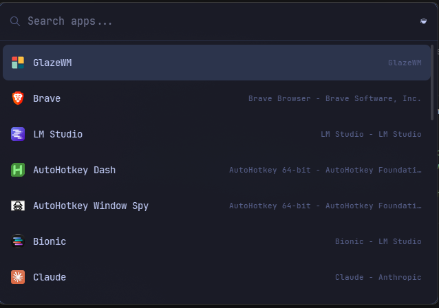

<div align="center">

# winRice

**Windows 11 em mosaico e controlado pelo teclado, nas cores do Tokyo Night.**


[English](README.md) · [Русский](README.ru.md) · [简体中文](README.zh-CN.md) · [Español](README.es.md) · **Português (BR)**

</div>

## Launcher

`Win` abre o launcher do winRice. O menu Iniciar nativo sai de cena: o AutoHotkey toma a tecla, então ela não invoca mais o shell do Windows — `Win+E`, `Win+D`, `Win+L` e `Win+S` são reimplementados em `autohotkey/win-launcher.ahk`.

<div align="center">
  
</div>

## Instalação

```powershell
git clone https://github.com/Erzkanzler2k/winRice
cd winRice
powershell -ExecutionPolicy Bypass -File install.ps1
```

Requer Windows 11 22H2+ e `winget`. O script instala GlazeWM, YASB, WezTerm, Starship, Fastfetch e AutoHotkey, copia as configurações, define o papel de parede, oculta os ícones da área de trabalho e registra a inicialização automática. É idempotente: rode de novo depois de qualquer alteração.

## Teclas

`Alt` ou `Win` + …

| Teclas | Ação |
|:--|:--|
| `H J K L` | focar janela |
| `Shift + H J K L` | mover janela |
| `1..9` | área de trabalho |
| `Shift + 1..9` | janela para a área |
| `R` | modo redimensionar (`Esc` sai) |
| `V` | direção do mosaico |
| `F` | tela cheia |
| `Shift + Space` | janela flutuante |
| `Q` | fechar |
| `Space` | launcher |
| `Alt + Tab` | alternar janelas da área de trabalho |
| `Enter` | WezTerm |
| `Shift + R` | recarregar configuração |

`Alt + S` / `Alt + A` — próxima / anterior área de trabalho. `Alt + Shift + E` — sair do GlazeWM.

## Arquivos

| No repositório | Instalado em |
|:--|:--|
| `glazewm/config.yaml` | `%USERPROFILE%\.glzr\glazewm\config.yaml` |
| `yasb/` | `%USERPROFILE%\.config\yasb\` |
| `wezterm/.wezterm.lua` | `%USERPROFILE%\.wezterm.lua` |
| `starship/starship.toml` | `%USERPROFILE%\.config\starship.toml` |
| `fastfetch/` | `%USERPROFILE%\.config\fastfetch\` |
| `autohotkey/win-launcher.ahk` | `%USERPROFILE%\.config\winrice\win-launcher.ahk` |
| `wallpaper/tokyonight.png` | `%USERPROFILE%\Pictures\winRice-wallpaper.png` |

Paleta: fundo `#1a1b26`, texto `#c0caf5`, destaque `#7aa2f7`, secundário `#565f89`.

## Notas

- A barra some com apps em tela cheia (`hide_on_fullscreen` em `yasb/config.yaml`).
- O GlazeWM esconde as outras áreas com *cloak*. Se o processo for morto, o cloak sobrevive ao reinício: `tools/rescue-windows.ps1` devolve essas janelas e desminimiza as que foram adotadas como minimizadas.
- `Win` pertence ao winRice, então as outras combinações com `Win` não chegam mais ao Windows: use a variante com `Alt`.
- Para devolver a tecla e manter o menu Iniciar: apague a entrada `winRice` de `HKCU:\Software\Microsoft\Windows\CurrentVersion\Run` e encerre o `AutoHotkey64.exe`.
- Logs: `~\.config\yasb\yasb.log`, `~\.glzr\glazewm\errors.log`.

## Créditos

[GlazeWM](https://github.com/glzr-io/GlazeWM) · [YASB](https://github.com/amnweb/yasb) · [WezTerm](https://wezterm.org) · [AutoHotkey](https://www.autohotkey.com) · [Starship](https://starship.rs) · [Fastfetch](https://github.com/fastfetch-cli/fastfetch) · [JetBrains Mono NF](https://github.com/ryanoasis/nerd-fonts) · paleta [Tokyo Night](https://github.com/folke/tokyonight.nvim) · inspirado no [Omarchy](https://github.com/basecamp/omarchy).

[MIT](LICENSE) © 2026 Erzkanzler2k
