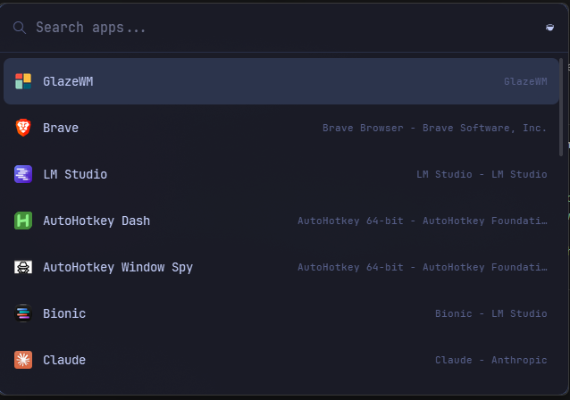

<div align="center">

# winRice

**Тайловый Windows 11 под клавиатуру, в палитре Tokyo Night.**


[English](README.md) · **Русский** · [简体中文](README.zh-CN.md) · [Español](README.es.md) · [Português (BR)](README.pt-BR.md)

</div>

## Лаунчер

`Win` открывает лаунчер winRice. Штатный Пуск больше не мешает: AutoHotkey забирает клавишу себе, поэтому вызвать оболочку Windows ею нельзя — `Win+E`, `Win+D`, `Win+L` и `Win+S` реализованы заново в `autohotkey/win-launcher.ahk`.

<div align="center">
  
</div>

## Установка

```powershell
git clone https://github.com/Erzkanzler2k/winRice
cd winRice
powershell -ExecutionPolicy Bypass -File install.ps1
```

Нужны Windows 11 22H2+ и `winget`. Скрипт ставит GlazeWM, YASB, WezTerm, Starship, Fastfetch и AutoHotkey, копирует конфиги, ставит обои, скрывает иконки рабочего стола и включает автозапуск. Идемпотентен — запускайте повторно после любой правки.

## Клавиши

`Alt` или `Win` + …

| Клавиши | Действие |
|:--|:--|
| `H J K L` | фокус окна |
| `Shift + H J K L` | переместить окно |
| `1..9` | рабочий стол |
| `Shift + 1..9` | окно на рабочий стол |
| `R` | режим ресайза (выход `Esc`) |
| `V` | направление укладки |
| `F` | полноэкранный режим |
| `Shift + Space` | плавающее окно |
| `Q` | закрыть |
| `Space` | лаунчер |
| `Enter` | WezTerm |
| `Shift + R` | перечитать конфиг |

`Alt + S` / `Alt + A` — следующий / предыдущий рабочий стол. `Alt + Shift + E` — выйти из GlazeWM.

## Файлы

| В репозитории | Куда ставится |
|:--|:--|
| `glazewm/config.yaml` | `%USERPROFILE%\.glzr\glazewm\config.yaml` |
| `yasb/` | `%USERPROFILE%\.config\yasb\` |
| `wezterm/.wezterm.lua` | `%USERPROFILE%\.wezterm.lua` |
| `starship/starship.toml` | `%USERPROFILE%\.config\starship.toml` |
| `fastfetch/` | `%USERPROFILE%\.config\fastfetch\` |
| `autohotkey/win-launcher.ahk` | `%USERPROFILE%\.config\winrice\win-launcher.ahk` |
| `wallpaper/tokyonight.png` | `%USERPROFILE%\Pictures\winRice-wallpaper.png` |

Палитра: фон `#1a1b26`, текст `#c0caf5`, акцент `#7aa2f7`, приглушённый `#565f89`.

## Заметки

- Бар скрывается в полноэкранных приложениях (`hide_on_fullscreen` в `yasb/config.yaml`).
- Клавиша `Win` принадлежит winRice, поэтому остальные её сочетания до Windows не доходят — используйте вариант с `Alt`.
- Вернуть клавишу и штатный Пуск: удалить запись `winRice` из `HKCU:\Software\Microsoft\Windows\CurrentVersion\Run` и завершить `AutoHotkey64.exe`.
- Логи: `~\.config\yasb\yasb.log`, `~\.glzr\glazewm\errors.log`.

## Благодарности

[GlazeWM](https://github.com/glzr-io/GlazeWM) · [YASB](https://github.com/amnweb/yasb) · [WezTerm](https://wezterm.org) · [AutoHotkey](https://www.autohotkey.com) · [Starship](https://starship.rs) · [Fastfetch](https://github.com/fastfetch-cli/fastfetch) · [JetBrains Mono NF](https://github.com/ryanoasis/nerd-fonts) · палитра [Tokyo Night](https://github.com/folke/tokyonight.nvim) · вдохновлено [Omarchy](https://github.com/basecamp/omarchy).

[MIT](LICENSE) © 2026 Erzkanzler2k
