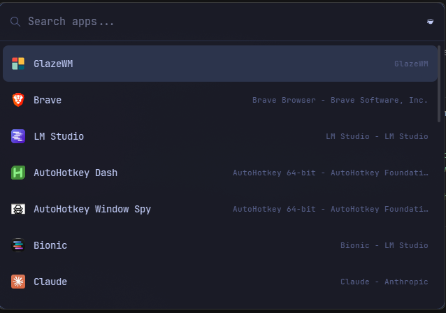

<div align="center">

# winRice

**为键盘而生的平铺式 Windows 11，配以 Tokyo Night 配色。**


[English](README.md) · [Русский](README.ru.md) · **简体中文** · [Español](README.es.md) · [Português (BR)](README.pt-BR.md)

</div>

## 启动器

按 `Win` 打开 winRice 启动器。系统自带的开始菜单不再出现：AutoHotkey 接管了这个键，因此它无法再召唤 Windows 外壳——`Win+E`、`Win+D`、`Win+L` 和 `Win+S` 在 `autohotkey/win-launcher.ahk` 中重新实现。

<div align="center">
  
</div>

## 安装

```powershell
git clone https://github.com/Erzkanzler2k/winRice
cd winRice
powershell -ExecutionPolicy Bypass -File install.ps1
```

需要 Windows 11 22H2+ 和 `winget`。脚本会安装 GlazeWM、YASB、WezTerm、Starship、Fastfetch 和 AutoHotkey，复制配置文件，设置壁纸，隐藏桌面图标并注册开机自启。脚本是幂等的——修改后重新运行即可。

## 快捷键

`Alt` 或 `Win` + …

| 按键 | 操作 |
|:--|:--|
| `H J K L` | 切换窗口焦点 |
| `Shift + H J K L` | 移动窗口 |
| `1..9` | 切换工作区 |
| `Shift + 1..9` | 把窗口移到工作区 |
| `R` | 调整大小模式（`Esc` 退出） |
| `V` | 切换平铺方向 |
| `F` | 全屏 |
| `Shift + Space` | 浮动窗口 |
| `Q` | 关闭窗口 |
| `Space` | 启动器 |
| `Alt + Tab` | 在当前工作区切换窗口 |
| `Enter` | WezTerm |
| `Shift + R` | 重新加载配置 |

`Alt + S` / `Alt + A` —— 下一个 / 上一个工作区。`Alt + Shift + E` —— 退出 GlazeWM。

## 文件

| 仓库内路径 | 安装到 |
|:--|:--|
| `glazewm/config.yaml` | `%USERPROFILE%\.glzr\glazewm\config.yaml` |
| `yasb/` | `%USERPROFILE%\.config\yasb\` |
| `wezterm/.wezterm.lua` | `%USERPROFILE%\.wezterm.lua` |
| `starship/starship.toml` | `%USERPROFILE%\.config\starship.toml` |
| `fastfetch/` | `%USERPROFILE%\.config\fastfetch\` |
| `autohotkey/win-launcher.ahk` | `%USERPROFILE%\.config\winrice\win-launcher.ahk` |
| `wallpaper/tokyonight.png` | `%USERPROFILE%\Pictures\winRice-wallpaper.png` |

配色：背景 `#1a1b26`，文字 `#c0caf5`，强调色 `#7aa2f7`，次要色 `#565f89`。

## 说明

- 全屏应用下状态栏会自动隐藏（`yasb/config.yaml` 里的 `hide_on_fullscreen`）。
- GlazeWM 通过 cloak 隐藏其他工作区的窗口。若进程被强杀，cloak 会残留——`tools/rescue-windows.ps1` 会把这些窗口取回，并恢复被误判为最小化的窗口。
- `Win` 归 winRice 所有，其余 `Win` 组合键无法到达 Windows——请使用 `Alt` 版本。
- 想交还 `Win` 键并保留系统开始菜单：删除 `HKCU:\Software\Microsoft\Windows\CurrentVersion\Run` 中的 `winRice` 项，并结束 `AutoHotkey64.exe`。
- 日志：`~\.config\yasb\yasb.log`、`~\.glzr\glazewm\errors.log`。

## 致谢

[GlazeWM](https://github.com/glzr-io/GlazeWM) · [YASB](https://github.com/amnweb/yasb) · [WezTerm](https://wezterm.org) · [AutoHotkey](https://www.autohotkey.com) · [Starship](https://starship.rs) · [Fastfetch](https://github.com/fastfetch-cli/fastfetch) · [JetBrains Mono NF](https://github.com/ryanoasis/nerd-fonts) · 配色 [Tokyo Night](https://github.com/folke/tokyonight.nvim) · 灵感来自 [Omarchy](https://github.com/basecamp/omarchy)。

[MIT](LICENSE) © 2026 Erzkanzler2k
